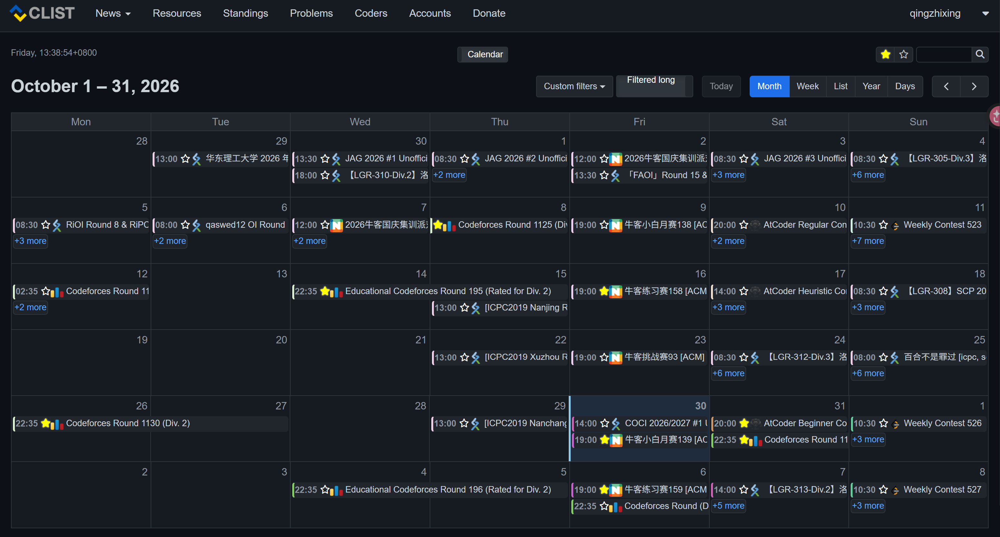
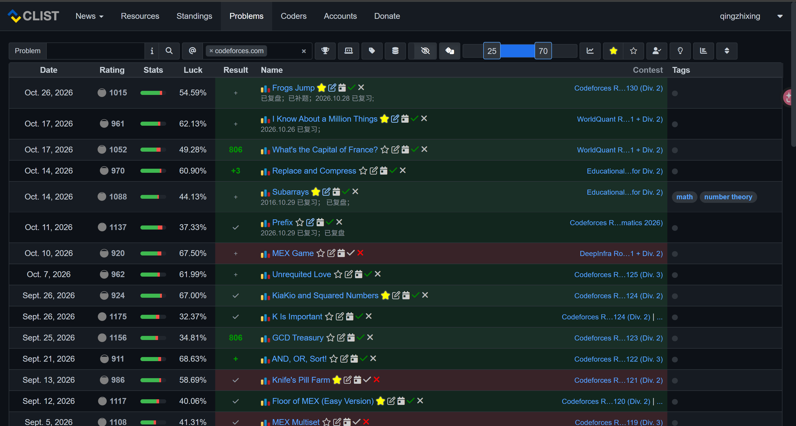
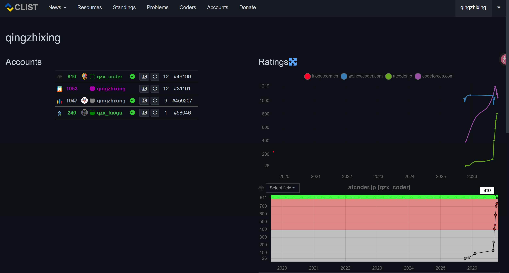

# CLIST Dark Mode

为 [clist.by](https://clist.by) 提供的暗色主题 UserStyle，覆盖竞赛列表、日历视图、Problems 页面、Standings 以及 Donate 页面。

## ✨ 特性

- **竞赛列表**（Contests）：暗色表格、交替行色、hover 高亮
- **日历视图**（Calendar）：完整暗色支持，包括「+N more」弹窗内容与工具栏（Month / Week / List / Year / Days、Today、前后翻页）
- **Problems 页面**：结果状态列用暗色语义背景（AC / WA / 未尝试）
- **Standings 页面**：排名行状态色（success / danger / info / warning）暗色适配
- **Donate 页面**：list-group 暗色化
- **Badge 语义色**：勾 / 叉 / 问号 / 减号用深色实底背景 + 亮灰图标，不再刺眼
- **标签页**：`nav-tabs` / `nav-pills` 暗色化，激活页签不再是白底
- **Bootstrap 组件**：按钮（含白色渐变）、提示条、分页、模态框、气泡卡片、面包屑、代码块等统一暗色

## 📦 安装

需要先安装 [Stylus](https://github.com/openstyles/stylus) 扩展（Chrome / Firefox / Edge 均可）。

### 方式一：从 UserStyles.world 安装（推荐，支持自动更新

在 [UserStyles.world](https://userstyles.world) 搜索「CLIST Dark Mode」，点击 Install。

### 方式二：从 GitHub Raw 直接安装

打开本仓库中的 `clist-dark.user.css` 文件，点击 Raw 按钮。Stylus 会自动识别 `.user.css` 链接并弹出安装对话框。

> ⚠️ 从 GitHub Raw 安装时，如果仓库路径或文件名发生变化，Stylus 的更新检查会失效。建议优先使用 UserStyles.world 的安装链接。

## 🖼️ 预览

## 🐛 反馈

有问题或建议请在本仓库的 [Issues](https://github.com/qingzhixing/Clist-Dark-Mode/issues) 页面提出。

## 📄 License

[GNU AGPL v3](LICENSE)
